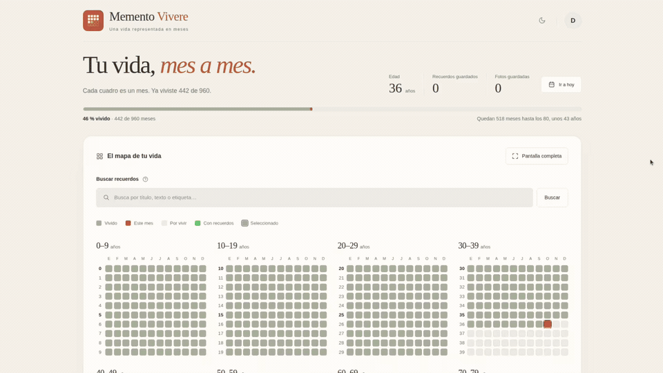

# Memento Vivere

## Demo



## ¿Qué es Memento Vivere?

Memento Vivere es una aplicación de reflexión personal y registro autobiográfico que permite visualizar el paso del tiempo y conservar los recuerdos que dan significado a nuestra existencia.

La aplicación representa la vida mediante una cuadrícula de pequeños cuadros, cada uno correspondiente a un período de tiempo.
Los cuadros transcurridos representan nuestra historia; los cuadros futuros, las páginas que todavía nos quedan por escribir.
Cada período puede contener recuerdos, fotografías, experiencias y reflexiones personales, formando progresivamente una autobiografía visual.

## Filosofía

### Memento Mori — Recuerda que morirás

*Memento Mori* es una expresión latina que nos recuerda nuestra mortalidad y la naturaleza limitada de nuestra existencia.
Esta idea ha estado presente durante siglos en distintas tradiciones filosóficas, especialmente en el estoicismo.
Reconocer que nuestro tiempo es finito puede ayudarnos a reflexionar sobre nuestras prioridades y aquello que realmente importa.

### Memento Vivere — Recuerda vivir

*Memento Vivere* complementa esa reflexión con una perspectiva centrada en la vida.
No se trata únicamente de recordar que algún día moriremos, sino de valorar las experiencias, los aprendizajes, las relaciones y los momentos que conforman nuestra historia.
Mientras *Memento Mori* nos recuerda que nuestro tiempo es limitado, *Memento Vivere* nos invita a vivirlo conscientemente.

## Inspiración: Your Life in Weeks

En 2014, el escritor **Tim Urban**, creador del blog *Wait But Why*, publicó el artículo **Your Life in Weeks**.
En él presentó una representación visual de una vida de 90 años mediante una cuadrícula de aproximadamente 4.680 cuadros, cada uno correspondiente a una semana.
La sencillez de esta representación permite observar algo que normalmente resulta abstracto: el tiempo de nuestra vida es finito y puede visualizarse.
Esta idea constituye una de las principales inspiraciones de Memento Vivere.
Sin embargo, mi propuesta busca incorporar una dimensión adicional.
**Cada cuadro no solo representa tiempo transcurrido, sino también una oportunidad de recordar lo vivido.**
Los cuadros dejan de ser únicamente unidades de tiempo para convertirse en pequeños contenedores de nuestra historia personal.

### Referencia y reconocimiento

Tim Urban — *Your Life in Weeks* (2014), Wait But Why.
[https://waitbutwhy.com/2014/05/life-weeks.html](https://waitbutwhy.com/2014/05/life-weeks.html)

Memento Vivere es un proyecto independiente inspirado conceptualmente en esta visualización, sin afiliación con Tim Urban ni Wait But Why.

## Funciones

- **Cuentas privadas:** cada persona tiene su propio perfil, recuerdos y fotografías.
- **Tu vida en meses:** visualiza los meses vividos y futuros en un mapa agrupado por décadas, con edad, progreso y cantidades de recuerdos y fotos.
- **Recuerdos con fecha flexible:** guarda varios recuerdos por mes.
- **Edición y eliminación:** modifica la fecha y el contenido de un recuerdo o elimínalo junto con sus fotografías.
- **Fotografías:** añade imágenes JPEG, PNG, WebP, AVIF, HEIC o HEIF y ábrelas a tamaño completo. Se guardan optimizadas en WebP.
- **Etiquetas y búsqueda:** organiza los recuerdos con etiquetas y busca por título, detalle o etiqueta.
- **Navegación por meses:** recorre el calendario, vuelve al mes actual o salta los meses sin recuerdos.
- **Mapa en pantalla completa:** amplía la cuadrícula conservando la búsqueda y el mes seleccionado.
- **Recuperación de cuenta:** recupera el acceso con ocho palabras privadas; después de usarlas recibirás otras que las reemplazan.
- **Cambio de contraseña:** cambia la contraseña desde el menú de tu cuenta, conservando la sesión actual y cerrando las demás.
- **Temas:** elige Claro, Oscuro o Auto y conserva tu preferencia al cambiar de pantalla.
- **Diseño adaptable:** utiliza la aplicación desde un computador, tableta o teléfono.
- **PWA instalable:** instala la aplicación desde el navegador.
- **Datos persistentes:** cuentas, sesiones, recuerdos y fotografías se conservan en PostgreSQL entre reinicios.

## Instalación

Requiere Docker y Docker Compose. Descarga [compose.prod.yaml](compose.prod.yaml) y [.env.example](.env.example) en una misma carpeta; no necesitas clonar el repositorio ni compilar.

1. Copia [.env.example](.env.example) como `.env` y configura `PGDATABASE`, `PGUSER` y una contraseña segura en `PGPASSWORD`.
2. Desde esa carpeta inicia la aplicación y PostgreSQL:

   ```bash
   docker compose -f compose.prod.yaml up -d
   ```

Abre [http://localhost:3000](http://localhost:3000) o `http://IP_DEL_SERVIDOR:3000` desde otro dispositivo. Puedes cambiar el puerto publicado mediante `APP_PORT`.

La base y el esquema se crean automáticamente al iniciar con una base vacía. Los datos se conservan en el volumen `memento-vivere_postgres_data`.

Para descargar una nueva versión y actualizar los contenedores, conservando los datos:

```bash
docker compose -f compose.prod.yaml pull
docker compose -f compose.prod.yaml up -d
```

Para detener ambos servicios:

```bash
docker compose -f compose.prod.yaml stop
```

Para consultar los últimos 100 registros de la aplicación y seguir los nuevos en tiempo real:

```bash
docker compose -f compose.prod.yaml logs -f --tail=100 app
```

### HTTPS con proxy inverso

Dirige el proxy al puerto de la aplicación (`3000` por defecto) y configura estas cabeceras, sobrescribiendo los valores enviados por el cliente:

| Cabecera | Valor | Función |
| --- | --- | --- |
| `X-Forwarded-Proto` | `https` | Reconocer HTTPS y emitir cookies `Secure`. |
| `X-Forwarded-Host` | Tu dominio público, con puerto si corresponde. | Reconocer el dominio público. |
| `X-Forwarded-For` | La IP del cliente, por ejemplo `$remote_addr` en Nginx. | Limitar los intentos de acceso por IP. |

Define `TRUSTED_PROXY_IP` en `.env` con la IP exacta desde la que el proxy llega al contenedor. La aplicación solo acepta esas cabeceras desde esa dirección y espera una única IP en `X-Forwarded-For`.

En los logs, `peerIp` identifica la conexión directa; `clientIp` aparece cuando el proxy autorizado envía una IP válida y distinta en `X-Forwarded-For`.

Si el proxy se ejecuta en el servidor anfitrión, esa dirección puede ser la puerta de enlace de Docker. Con la red del proyecto creada, puedes consultarla:

```bash
sudo docker network ls --format '{{.Name}}'
sudo docker network inspect memento-vivere_default --format '{{range .IPAM.Config}}{{println .Gateway}}{{end}}'
```

Ajusta el nombre si tu red es diferente. Si devuelve `172.20.0.1` y coincide con el `peerIp` del proxy, usa `TRUSTED_PROXY_IP=172.20.0.1`. Si el proxy está en otro contenedor, utiliza la IP de ese contenedor.

Compose transmite la variable automáticamente; no necesitas modificar `command`. Después de configurarla, aplica el cambio con `docker compose -f compose.prod.yaml up -d`. En HTTPS, restringe el acceso al puerto de la aplicación (`3000` por defecto) para que solo pueda conectarse el proxy.

Inicio de sesión, registro, recuperación y cambio de contraseña comparten un límite de 20 solicitudes cada 15 minutos por IP. Login y recuperación tienen además límites por usuario.

### Aplicación instalable (PWA)

La PWA funciona con la compilación de producción y HTTPS; `localhost` también permite probarla. En navegadores compatibles aparece **Instalar aplicación** en el menú de tu cuenta. En iPhone/iPad usa **Compartir → Añadir a pantalla de inicio**.

Iniciar sesión y consultar o modificar recuerdos y fotos requiere conexión al servidor.

## Desarrollo

Configura `.env` como se indica en Instalación. Puedes trabajar de estas dos formas:

### Todo con Docker

Para compilar y ejecutar desde el código fuente:

```bash
docker compose up -d --build
```

Abre [http://localhost:3000](http://localhost:3000). Para detener los servicios conservando los datos, ejecuta `docker compose stop`.

### PostgreSQL en Docker y aplicación con Node.js

Requiere Node.js 22 o posterior (recomendado 24), npm y Linux con `heif-thumbnailer`, `util-linux` y los plugins de libheif para HEVC y AV1. En Debian Trixie, estos plugins son `libheif-plugin-libde265` y `libheif-plugin-aomdec`; Docker ya incluye esas dependencias.

1. Añade a `.env` la dirección y el puerto publicado de PostgreSQL:

   ```dotenv
   PGHOST=127.0.0.1
   PGPORT=5433
   ```

2. Inicia solo la base y espera a que esté disponible:

   ```bash
   docker compose up -d --wait database
   ```

3. Instala las dependencias y arranca la aplicación:

   ```bash
   npm ci
   npm run dev
   ```

Abre [http://localhost:3000](http://localhost:3000). El servidor crea el esquema automáticamente si la base está vacía. Si cambias el puerto publicado de PostgreSQL, ajusta también `PGPORT`.

Para terminar, pulsa `Ctrl+C` y ejecuta `docker compose stop database`. Si la aplicación de Docker sigue iniciada, detenla con `docker compose stop app` antes de ejecutar Node para dejar libre el puerto `3000`. Puedes usar otro puerto para Node con `npm run dev -- --port 3001`.

## Documentación

| Guía | Contenido |
| --- | --- |
| [Arquitectura](docs/architecture.md) | Organización del código y flujo de datos. |
| [Base de datos](docs/database.md) | Configuración, inicialización, tablas, backups y restauración. |

## Licencia

Copyright 2026 Roger Vega.

Este proyecto se distribuye bajo la [Apache License 2.0](LICENSE). Consulta
también el archivo de [atribuciones](NOTICE). Las dependencias de terceros
conservan sus respectivas licencias.
