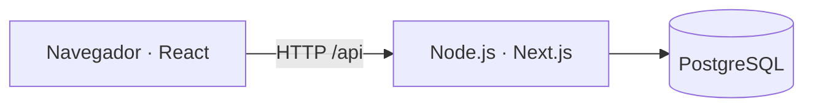

# Arquitectura

La interfaz utiliza React y TypeScript. Next.js sirve la web y la API en un mismo proceso Node.js, con PostgreSQL como almacenamiento.

Tanto en desarrollo como en Docker, `server.mjs` prepara la base antes de aceptar peticiones y obtiene la IP de cada conexión. Solo confía en las cabeceras de un proxy configurado mediante `TRUSTED_PROXY_IP`.

## Organización del código

| Ruta | Responsabilidad |
| --- | --- |
| `src/components/memento-app.tsx` | Composición de la aplicación, sesión y estado del calendario. |
| `src/components/` | Formularios, mapa de vida, recuerdos, fotos, menús, diálogos y hooks. |
| `src/components/api.ts` | Solicitudes HTTP e identificación de la cuenta mostrada. |
| `src/app/` | Entrada de Next.js, metadatos y estilos de la aplicación. |
| `src/app/api/` | Rutas HTTP de cuentas, perfil, recuerdos y fotografías. |
| `src/domain/` | Tipos, calendario, búsqueda y validaciones compartidos. |
| `src/server/auth.mjs` y `src/server/auth-http.ts` | Hashes, palabras de recuperación, cookies y comprobación de sesión. |
| `src/server/auth-rate-limit.ts` | Ventanas de solicitudes por IP y usuario. |
| `src/server/store.ts` y `src/server/storage.ts` | Instancia compartida del almacenamiento PostgreSQL. |
| `src/server/postgres/` | Conexión, inicialización, consultas y transacciones. |
| `src/server/images.mjs` y `src/server/*heic.mjs` | Conversión de fotografías a WebP y limpieza de temporales. |
| `src/instrumentation.ts` y `src/server/logger.mjs` | Logs de arranque, solicitudes y errores. |
| `server.mjs` | Arranque HTTP, contexto de red y cierre del servidor. |
| `db/001_initial.sql` | Esquema, índices, vista de recuerdos visibles y triggers. |
| `tests/` | Pruebas de dominio, rutas, repositorios, imágenes e interfaz. |

## Flujo de una operación

1. La interfaz realiza una solicitud mediante `src/components/api.ts`.
2. La API comprueba origen, sesión, propietario y datos recibidos; las rutas de autenticación aplican sus límites de solicitudes.
3. Si hay fotografías nuevas, el servidor las convierte a WebP antes de abrir la transacción de guardado.
4. El repositorio revalida la sesión y guarda los cambios del usuario en una transacción. Las versiones de recuerdos evitan sobrescribir ediciones simultáneas.
5. La API devuelve el resultado y la interfaz actualiza su estado.

Cuentas, perfiles, sesiones, recuerdos y fotografías se guardan en PostgreSQL. El navegador conserva la preferencia de tema. Los límites temporales de solicitudes y el bloqueo de conversión son locales al proceso; deben coordinarse antes de usar varias réplicas.
