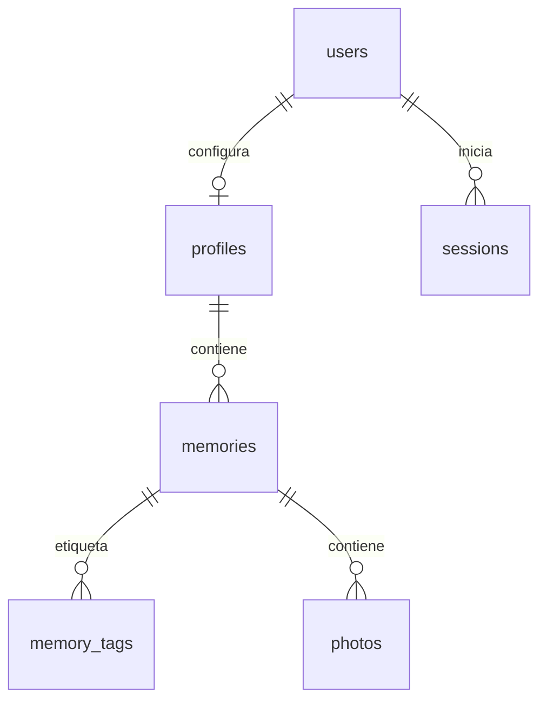

# Base de datos

La aplicación utiliza PostgreSQL 18 con UTF-8. Compose ejecuta `database` y `app` en contenedores separados, con el volumen `memento-vivere_postgres_data` para los datos.

Los comandos de esta guía son para ejecución manual desde la raíz del proyecto y utilizan `compose.yaml`. Si usas la imagen publicada, añade `-f compose.prod.yaml` después de `docker compose`; ambos archivos conservan el mismo nombre de proyecto y volumen.

## Configuración

Crea la configuración local a partir de la plantilla:

```bash
cp -n .env.example .env
```

Edita el archivo creado y sustituye los valores de ejemplo:

| Variable | Uso |
| --- | --- |
| `PGDATABASE` | Nombre de la base de esta aplicación. |
| `PGUSER` | Rol PostgreSQL utilizado por la aplicación y propietario del esquema. |
| `PGPASSWORD` | Contraseña de ese rol. |

La imagen crea la base y el rol solo al inicializar un volumen vacío. Cambiar esas variables después no modifica las credenciales ya guardadas.

Dentro de Compose, la aplicación se conecta a `database:5432`. Para Node fuera de Docker, configura además `PGHOST=127.0.0.1` y `PGPORT=5433`, o el puerto publicado que hayas elegido. La conexión utiliza la red privada de Docker o localhost.

Antes de aceptar peticiones, el servidor crea el [esquema inicial](../db/001_initial.sql) si la base está vacía. En una base existente comprueba tablas, vista y columnas; un esquema incompleto detiene el arranque. No ejecuta migraciones ni modifica automáticamente esquemas existentes.

## Tablas

Todas las tablas pertenecen al esquema `memento`.



| Tabla | Datos y reglas principales |
| --- | --- |
| `users` | UUID, usuario único sin distinguir mayúsculas, hashes de contraseña y recuperación, y `login_attempts`. Un acceso o recuperación correctos reinician el contador. |
| `profiles` | Un perfil por cuenta: nacimiento y `horizon_years` positivo, con 80 años por defecto. Cambiar el horizonte por SQL ajusta la cuadrícula al actualizar la pantalla. |
| `sessions` | Hash SHA-256 del token, propietario y vencimiento a siete días. Cerrar sesión elimina su fila. |
| `memories` | Propietario, título, detalle, año, mes, día opcional y versión para controlar ediciones simultáneas. El día desconocido permanece `NULL`. |
| `memory_tags` | Etiquetas propias de cada recuerdo, sin orden ni posiciones. Un índice impide etiquetas equivalentes repetidas en el mismo recuerdo. |
| `photos` | WebP binario, recuerdo propietario, posición de galería, dimensiones positivas y `size_bytes` calculado desde los bytes guardados. |

`users`, `profiles`, `sessions`, `memories` y `photos` tienen `created_at` y `updated_at`. Los triggers igualan ambas fechas al insertar y actualizan la segunda cuando cambian datos. Una actualización sin cambios conserva la fecha anterior.

La vista `visible_memories` filtra recuerdos entre el nacimiento y hoy. Cada consulta también limita los resultados al usuario autenticado. Eliminar un recuerdo elimina sus etiquetas y fotos mediante claves foráneas en cascada.

Los cambios de un recuerdo, sus etiquetas y sus fotos se confirman juntos o se revierten completos. Las restricciones de la base mantienen relaciones, unicidad y fechas válidas; los límites de producto se validan en la aplicación.

## Persistencia

El volumen se monta en `/var/lib/postgresql`. Reiniciar, reconstruir o recrear los contenedores conserva los datos mientras se mantenga el volumen. El nombre del proyecto Compose determina qué volumen se utiliza.

Las fotos forman parte de la base y de sus backups. Se conserva únicamente WebP optimizado, sin originales ni EXIF.

## Crear un backup

El backup completo se guarda en el directorio desde donde ejecutes el comando:

```bash
docker compose exec -T database sh -c 'exec pg_dump --username "$POSTGRES_USER" --dbname "$POSTGRES_DB" --format=custom --no-acl' > "memento-vivere-$(date +%Y%m%d-%H%M%S).dump"
```

## Restaurar un backup

**La restauración reemplaza los datos actuales por los del backup.** No elimines el volumen de PostgreSQL.

Ejecuta los pasos con PostgreSQL encendido y en la misma terminal. Continúa al siguiente paso solo si el anterior termina sin errores.

1. Selecciona el archivo real y comprueba que exista y que su índice pueda leerse:

   ```bash
   backup_file='REEMPLAZAR_POR_EL_BACKUP.dump'
   test -s "$backup_file" && docker compose exec -T database pg_restore --list < "$backup_file"
   ```

   Si no aparece el índice o hay errores, no continúes. Leer el índice no verifica todos los datos del archivo.

2. Detén la aplicación para impedir escrituras y la inicialización automática durante la restauración. Si ejecutaste `npm run dev`, detenlo con `Ctrl+C`. Para la aplicación en Docker:

   ```bash
   docker compose stop app
   ```

3. Borra y vuelve a crear la base de destino vacía:

   ```bash
   docker compose exec -T database sh -c '
     dropdb --maintenance-db=template1 --username "$POSTGRES_USER" --if-exists --force -- "$POSTGRES_DB" &&
     createdb --maintenance-db=template1 --username "$POSTGRES_USER" --owner "$POSTGRES_USER" -- "$POSTGRES_DB"
   '
   ```

4. Restaura esquema y datos en una sola transacción. Si falla, no inicies la aplicación:

   ```bash
   docker compose exec -T database \
     sh -c 'exec pg_restore --username "$POSTGRES_USER" --dbname "$POSTGRES_DB" --single-transaction --exit-on-error --no-owner --no-acl' \
     < "$backup_file"
   ```

5. Invalida las sesiones recuperadas para que todos vuelvan a iniciar sesión:

   ```bash
   docker compose exec -T database \
     sh -c 'exec psql --username "$POSTGRES_USER" --dbname "$POSTGRES_DB" --set ON_ERROR_STOP=1 --command="DELETE FROM memento.sessions;"'
   ```

6. Inicia la aplicación con `npm run dev` o, para Docker, con:

   ```bash
   docker compose up -d app
   ```

Comprueba el acceso, el mapa, los recuerdos y las fotografías. No ejecutes `db/001_initial.sql`: el backup ya contiene el esquema.

## Borrar la base e iniciar de cero

**Estos pasos eliminan todas las cuentas, sesiones, perfiles, recuerdos, etiquetas y fotografías.** Si quieres conservarlos, crea primero un [backup](#crear-un-backup).

1. Detén la aplicación y deja PostgreSQL encendido. Si ejecutaste `npm run dev`, detenlo antes con `Ctrl+C`:

   ```bash
   docker compose stop app
   docker compose up -d --wait database
   ```

2. Borra y vuelve a crear la base. Continúa solo si el comando termina sin errores:

   ```bash
   docker compose exec -T database sh -c '
     dropdb --maintenance-db=template1 --username "$POSTGRES_USER" --if-exists --force -- "$POSTGRES_DB" &&
     createdb --maintenance-db=template1 --username "$POSTGRES_USER" --owner "$POSTGRES_USER" -- "$POSTGRES_DB"
   '
   ```

3. Inicia la aplicación con `npm run dev` o, para Docker, con:

   ```bash
   docker compose up -d app
   ```

El servidor creará automáticamente el esquema en la base vacía. Abre la aplicación y registra tu cuenta nuevamente.
